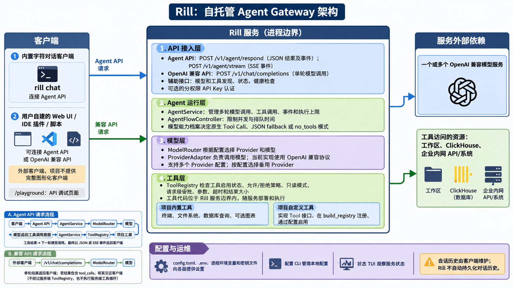

# Rill

```text
 █▀█ █ █   █
 █▀▄ █ █   █
 ▀ ▀ ▀ ▀▀▀ ▀▀▀
```

**Less is more. Simplicity is beauty.**

Rill 是一个轻量、自托管的 Agent Gateway。配置一个或多个 OpenAI 兼容模型
服务并启动 Rill 后，提供可供客户端调用的 HTTP API：Agent API 在服务端
完成模型与工具的多轮循环，以 JSON 或 SSE 返回结果；
可以通过 HTTP API 将 Rill 接入自己的 Web UI、IDE 插件或任何自动化流程。

## Why Rill？

| 你的需求                   | 推荐                      | 原因                     |
| ---------------------- | ----------------------- | ---------------------- |
| 终端里的成熟 AI coding agent | **Claude Code 或 Codex** | 客户端体验和编程工作流更完整         |
| IDE 集成开发环境             | **IDE 原生 Agent**        | 编辑器集成更深                |
| 自托管 Agent API          | **Rill**                | 一个小服务，接入任意 OpenAI 兼容模型 |
| 服务端工具循环                | **Rill**                | HTTP/SSE 接口简单，工具在服务端执行 |
| 按需扩展工具                 | **Rill**                | 小型可靠底座，配合 Skill 开发扩展   |
| 小团队内部运维自动化             | **Rill**                | 配置少、部署简单、权限可控          |

> [!NOTE]
>
> 当前项目仅提供 `rill chat` 字符客户端，没有完整的图形化客户端；
> 你可以在编程助手中参考 [API 文档](docs/API.md) 将 Rill 集成到自己的系统，或从零开发一个图形化客户端。

## 架构



`/v1/chat/completions` 只执行一轮兼容模型调用；`/v1/agent/*` 执行服务端
Agent 循环：模型提出工具调用，Rill 检查策略并执行，再将工具结果送回模型，
直到得到最终回答或达到限制。工具由配置启用，并经过允许/拒绝、审批、超时和
结果大小检查；完整边界见[架构文档](docs/ARCHITECTURE.md)。

## 快速开始

### 安装 uv

没有 uv 时先安装：

```bash
curl -LsSf https://astral.sh/uv/install.sh | sh
```

### 本地运行

在仓库根目录执行：

```bash
uv sync
cp config.toml.example config.toml
cp .env.example .env
```

编辑 `config.toml`，设置模型和模型服务地址：

```toml
[llm]
model = "deepseek-v4-flash"
api_base_url = "https://api.deepseek.com"
```

编辑 `.env`，填入 API Key：

```bash
ORIONXCORE_LLM__API_KEY=replace-me
```

检查并启动服务：

```bash
uv run rill config check
uv run rill serve
```

`rill serve` 读取 `[server].host` 和 `[server].port`，默认监听
`0.0.0.0:8080`。另开终端验证：

```bash
curl http://127.0.0.1:8080/health/ready
uv run rill ask "列出当前工作区中的文件。"
uv run rill chat
```

`rill chat` 在工具需要审批时会显示工具名称并询问 `y/N`；输入 `y` 后会重试
当前轮次并执行该工具。也可以在启动 chat 时预批准工具：

```bash
uv run rill chat --approve-tool run_terminal_command --approve-tool filesystem
```

也可以用 `uv run uvicorn rill.main:app --host 0.0.0.0 --port 8080` 启动；
这时监听地址由 Uvicorn 参数决定。

### Docker

```bash
cp config.toml.example config.toml
cp .env.example .env
```

编辑 `config.toml` 中的 `[llm]`，并在 `.env` 中填入：

```bash
ORIONXCORE_LLM__API_KEY=replace-me
```

启动并检查：

```bash
docker compose -f deploy/docker-compose.yml up -d --build
curl http://127.0.0.1:8080/health/ready
```

停止服务：

```bash
docker compose -f deploy/docker-compose.yml down
```

## 工具

考虑我司产品主要运行在内网。Rill 的工具按项目内的 `Tool` 接口开发，在
`build_registry` 中注册并通过配置启用，随 Rill 服务一起部署和执行。
接入现有内网 API 或数据库时，可以在工具中封装调用逻辑，无需为工具调用
单独部署服务；目标系统的网络连通和认证仍需按实际环境配置。

默认启用终端、文件系统和数据库工具；图表工具需要显式开启：生产环境请评估保留最小化工具开启。

```bash
uv run rill tool list
uv run rill tool enable tool_name
```

终端和文件系统的写操作需要请求级批准：

```bash
uv run rill ask \
  --approve-tool run_terminal_command \
  --approve-tool filesystem \
  "列出当前工作区中的文件"
```

HTTP 客户端在 Agent 请求中传入相同的 `approved_tools` 数组。OpenAI 兼容的
`/v1/chat/completions` 由客户端负责工具调用；需要服务端自动循环时使用
`/v1/agent/respond` 或 `/v1/agent/stream`。添加自定义工具的完整流程见
[工具开发文档](docs/TOOLS.md)和[开发 Skill](skills/tool-development/SKILL.md)。

## API

| 入口 | 用途 |
| --- | --- |
| `GET /health/live` | 进程存活检查 |
| `GET /health/ready` | 配置和工作区就绪检查 |
| `GET /v1/models` | 查看配置的模型 |
| `GET /v1/tools` | 查看已启用工具及审批元数据 |
| `POST /v1/agent/respond` | 服务端执行 Agent 循环并返回完整结果 |
| `POST /v1/agent/stream` | 以 SSE 流式返回 Agent 事件 |
| `POST /v1/chat/completions` | OpenAI 兼容的一轮调用 |

最小 Agent 请求：

```bash
curl -sS -X POST http://127.0.0.1:8080/v1/agent/respond \
  -H 'Content-Type: application/json' \
  -d '{"messages":[{"role":"user","content":"列出工作区中的文件。"}]}'
```

## 文档

- [配置](docs/CONFIGURATION.md)
- [安装](docs/INSTALL.md)
- [部署](docs/DEPLOYMENT.md)
- [架构](docs/ARCHITECTURE.md)
- [工具开发](docs/TOOLS.md)
- [API 接口](docs/API.md)
- [依赖](docs/dependencies.md)
- [产品计划](docs/PRODUCT_PLAN.md)

English: [README_en.md](README_en.md).
