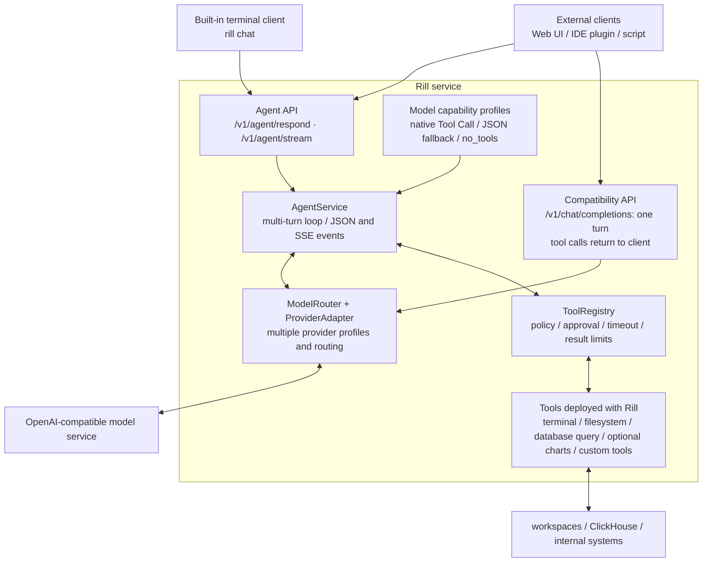

# Rill

```text
 █▀█ █ █   █
 █▀▄ █ █   █
 ▀ ▀ ▀ ▀▀▀ ▀▀▀
```

**Less is more. Simplicity is beauty.**

Rill is a small self-hosted Agent Gateway. Configure one or more
OpenAI-compatible model providers and start Rill to expose an HTTP service:
the Agent API runs model and tool turns on the server and returns JSON or SSE
results, while the OpenAI-compatible API makes one model turn. Use the `rill chat`
terminal client, or connect your own Web UI, IDE plugin, or script through the
HTTP APIs:

```text
client -> Rill Agent API -> server-side model/tool loop
client -> Rill compatibility API -> one model turn (tool calls return to client)
```

One service and one config file can route requests across multiple providers.

## Why Rill?

| Need | Recommendation | Why |
| --- | --- | --- |
| A polished AI coding agent for your terminal | **Claude Code or Codex** | Better client experience and coding workflows |
| An IDE coding assistant | **GitHub Copilot or an IDE-native agent** | Deep editor integration |
| A self-hosted Agent API for your own app | **Rill** | One small service, any OpenAI-compatible model |
| A server-side tool loop behind a Web UI, script, or plugin | **Rill** | HTTP/SSE in, tool events out |
| A private ClickHouse natural-language query service | **Rill** | Built-in schema-aware Text-to-SQL tool |
| A small-team operations assistant or automation service | **Rill** | Small deployment and explicit tool policy |
| A high-concurrency distributed Agent platform | **A managed platform** | Rill has no distributed scheduler or elastic cluster |
| A fully managed AI platform | **A managed provider** | Less infrastructure to operate |

The project only provides the `rill chat` terminal client. It does not include
a full graphical client; `/playground` is for API debugging only. You can use
an AI coding Skill and the [API documentation](docs/API.md) to integrate Rill
into your own system or build a graphical client from scratch.

## Architecture



The compatibility API makes one model turn and returns tool calls to the client.
The Agent API runs the server-side loop: Rill applies tool policy, executes tool
calls, and sends results back to the model until it answers or reaches a limit.
Terminal and filesystem tools also enforce workspace boundaries. See
[Architecture](docs/ARCHITECTURE.md) for the full boundary and event model.

## Quickstart

### Local

Copy and run this from the repository root:

```bash
uv sync
cp config.toml.example config.toml
cp .env.example .env
```

Set `[llm].model` and `[llm].api_base_url` in `config.toml`, then put the
provider key in `.env`:

```bash
ORIONXCORE_LLM__API_KEY=replace-me
```

Start the service from the configuration:

```bash
uv run rill config check
uv run rill serve
```

`rill serve` reads `[server].host` and `[server].port` and defaults to
`0.0.0.0:8080`. Uvicorn can still override them explicitly.

In another terminal:

```bash
uv run rill ask "List the files in the current workspace."
uv run rill chat
curl http://127.0.0.1:8080/health/ready
open http://127.0.0.1:8080/playground
```

When a tool needs approval, `rill chat` prompts with `y/N` and retries the
current turn after confirmation. Pre-approve tools for every turn at startup:

```bash
uv run rill chat --approve-tool run_terminal_command --approve-tool filesystem
```

Replace `replace-me` with an API key for the provider in `config.toml`.

### Docker

```bash
cp config.toml.example config.toml
printf '%s\n' 'ORIONXCORE_LLM__API_KEY=replace-me' > .env
docker compose -f deploy/docker-compose.yml up -d --build
curl http://127.0.0.1:8080/health/ready
```

Stop it with:

```bash
docker compose -f deploy/docker-compose.yml down
```

More deployment options: [Deployment](docs/DEPLOYMENT.md).

## Configuration

The smallest useful configuration is already in `config.toml.example`:

```toml
[llm]
model = "gpt-4.1-mini"
api_base_url = "https://api.openai.com/v1"
```

Secrets stay in `.env` or a Docker Secret. Validate before starting:

```bash
uv run rill config check
uv run rill config show
```

For provider profiles, model aliases, authentication, tool policy, and Docker
Secrets, see [Configuration](docs/CONFIGURATION.md).

## Tools

Many company products run on internal networks. Rill tools implement the
project's `Tool` interface, are registered in `build_registry`, and run with
the Rill service. A tool can wrap an existing internal API or database without
requiring a separate service for tool execution; connectivity and credentials
for the target system still need to be configured in that environment.

Terminal, filesystem, and database tools are enabled by default. The chart tool
is opt-in:

```bash
uv run rill tool list
uv run rill tool enable generate_chart
```

Database starts without a connection URL and reports a configuration error only
when called. Terminal execution and filesystem writes require request approval:

```bash
uv run rill ask --approve-tool run_terminal_command "show the current directory"
```

To add a tool, implement `Tool`, register it in `build_registry`, add its
configuration switch, and test its policy metadata:

```text
src/rill/tools/<your_tool>.py
```

Read [Tool development](docs/TOOLS.md) or the project skill at
[`skills/tool-development/SKILL.md`](skills/tool-development/SKILL.md).

## API

```text
GET  /health/live
GET  /health/ready
GET  /v1/models
GET  /v1/tools
POST /v1/agent/respond
POST /v1/agent/stream
POST /v1/chat/completions
```

Example Agent request:

```bash
curl -sS -X POST http://127.0.0.1:8080/v1/agent/respond \
  -H 'Content-Type: application/json' \
  -d '{"messages":[{"role":"user","content":"List the files in the workspace."}]}'
```

## Docs

- [Configuration](docs/CONFIGURATION.md)
- [Installation](docs/INSTALL.md)
- [Deployment](docs/DEPLOYMENT.md)
- [Architecture](docs/ARCHITECTURE.md)
- [Tools](docs/TOOLS.md)
- [API](docs/API.md)
- [Dependencies](docs/dependencies.md)
- [Product plan](docs/PRODUCT_PLAN.md)

Chinese overview: [README.md](README.md).
